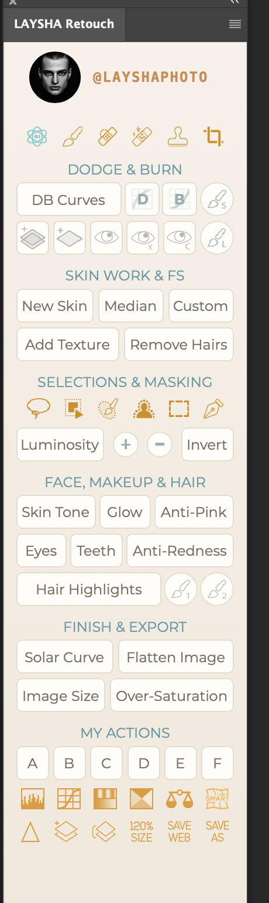
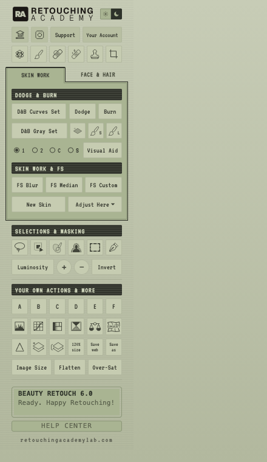

# LAYSHA Retouch — панель ретуши для Photoshop

Бесплатная **UXP-панель ретуши** для Adobe Photoshop с открытым кодом — компактная панель 208 px
с Dodge & Burn, частотным разложением, световыми масками и ежедневными помощниками ретушёра
в один клик.

Без лицензий, без аккаунтов, без серверов, без обфускации. Просто HTML + CSS + один читаемый `index.js`.



## Почему

Коммерческие панели ретуши — это обычно тонкая HTML-оболочка над вызовами Photoshop `batchPlay`,
запертая за лицензионными серверами. Эта панель делает ту же работу с полностью открытым,
прокомментированным кодом, который можно читать, менять и расширять.

## Возможности

**Ряд инструментов** — Кисть, Точечная восстанавливающая, Удаление, Штамп, Кадрирование.

**DODGE & BURN**
- `DB Curves` — группа кривых Dodge + Burn с чёрными масками (скрыть всё), кисть выбирается автоматически
- `D` / `B` — одиночная кривая Dodge или Burn
- Глобальный D&B слой 50% серого (Soft Light), слой 50% серого в Overlay
- Контрольные слои Visual Aid (ч/б просмотр, сильный контраст и др.)

**SKIN WORK & FS (Работа с кожей и ЧР)**
- `New Skin` — частотное разложение (Gaussian Blur 8 px)
- `Median` — частотное разложение (Median 10 px)
- `Add Texture` — цифровая текстура кожи (50% серый + монохромный шум, Overlay)
- `Remove Hairs` — новый слой + Точечная восстанавливающая кисть

**SELECTIONS & MASKING (Выделения и маски)**
- Лассо, Объектное выделение, Кисть выделения, Выделить объект, Прямоугольная область, Перо
- `Luminosity` — световое выделение из канала RGB, операции `+` / `−` с каналами, `Invert`

**FACE, MAKEUP & HAIR (Лицо, макияж, волосы)**
- Skin Tone, Anti-Pink, Anti-Redness — слои Hue/Saturation с чёрными масками
- Осветление глаз / зубов (рисуешь по маске)
- Glow (Blur 30 px + Soft Light 50%, с маской)
- Кривая Hair Highlights + быстрые белая/чёрная кисти

**FINISH & EXPORT (Финал и экспорт)**
- Solar Curve (проверка тонов), Flatten Image, диалог Image Size
- Проверка перенасыщения (трюк с Selective Color)

**MY ACTIONS (Свои экшены)**
- `A`–`F` запускают твои собственные экшены (см. раздел ниже)
- Быстрые корректирующие слои: Levels, Curves, Hue/Saturation, Selective Color, Color Balance
- Liquify, Sharpen (Stamp Visible + High Pass + Overlay), новый слой, Stamp Visible,
  размер 120 %, Save for Web (2048 px), Save As

## Установка

Установщик не нужен — UXP-панели это обычные папки. В комплекте две панели, ставь одну или обе:
**MyRetouchPanel** (пастельная, классический вид) и **MyRetouchPanel6** (вкладки и темы, новый вид).

### Шаг 1 — Скачать

На этой странице GitHub нажми **Code → Download ZIP** и распакуй архив.
(Или `git clone`, если пользуешься git.)

### Шаг 2 — Скопировать папку(и) панели

Скопируй `MyRetouchPanel` и/или `MyRetouchPanel6` в папку UXP-плагинов Photoshop:

- **Windows:** `%APPDATA%\Adobe\UXP\Plugins\External\`
  (вставь этот путь в адресную строку Проводника)
- **macOS:** `~/Library/Application Support/Adobe/UXP/Plugins/External/`
  (в Finder нажми `⌘⇧G` и вставь путь; если папок нет — создай)

### Шаг 3 — Зарегистрировать панель(и)

> **Важно:** перед правкой `PS.json` **полностью закрой Photoshop** — при выходе он
> перезаписывает этот файл и стирает твои изменения. Отредактируй файл, сохрани,
> и только потом запускай Photoshop.

В той же папке `Adobe/UXP` открой `PluginsInfo/v1/PS.json`
(если папок или файла нет — создай их). Добавь по одной записи на каждую панель
внутрь `"plugins": [ … ]`:

```json
{
  "plugins": [
    {
      "hostMinVersion": "23.3.0",
      "name": "LAYSHA Retouch",
      "path": "$localPlugins/External/MyRetouchPanel",
      "pluginId": "com.kimi.myretouchpanel",
      "status": "enabled",
      "type": "uxp",
      "versionString": "1.0.0"
    },
    {
      "hostMinVersion": "26.0.0",
      "name": "LAYSHA Retouch",
      "path": "$localPlugins/External/MyRetouchPanel6",
      "pluginId": "com.kimi.myretouchpanel6",
      "status": "enabled",
      "type": "uxp",
      "versionString": "1.0.0"
    }
  ]
}
```

Если в файле уже есть другие плагины — не удаляй их, просто добавь эти записи.

### Шаг 4 — Включить режим разработчика и перезапустить Photoshop

В Photoshop: `Редактирование → Настройки → Plugins (Модули)` → включи
**«Enable Developer Mode» / «Режим разработчика»**.
Без него сторонние неподписанные UXP-панели не загружаются.

Перезапусти Photoshop → меню **Plugins** → **LAYSHA Retouch**. Готово.

**Если панели не появились (Windows или macOS):**
1. `PS.json` редактировался при запущенном Photoshop → он перезаписался.
   Сделай Шаг 3 заново при закрытом PS.
2. Проверь, что JSON валиден — без висячих запятых, один массив `"plugins": [ ... ]` наверху.
3. `pluginId` должен точно совпадать с `id` из `manifest.json` каждой панели.
4. Photoshop ≥ 23.3 для MyRetouchPanel, ≥ 26.0 для MyRetouchPanel6.

**Альтернатива (путь разработчика):** открой [UXP Developer Tool](https://developer.adobe.com/photoshop/uxp/2022/guides/devtool/installation/),
`Add Plugin…` → выбери `MyRetouchPanel/manifest.json` → `Load`. Править PS.json не нужно.

Требуется Photoshop **23.3 или новее** (UXP-панели).

## Свои экшены (кнопки A–F)

Кнопки **A B C D E F** запускают *твои собственные* экшены Photoshop. Правила:

1. Открой панель **Операции (Actions)** в Photoshop (`Окно → Операции`).
2. Рекомендуется: создай набор (папку) с точным именем `My Panel Actions` и запиши внутри
   экшены с именами `A`, `B`, `C`, `D`, `E`, `F` (одна буква).
3. Готово — кнопка A играет экшен `A`, кнопка B — экшен `B` и так далее. Работает в обеих панелях.

Если набора `My Panel Actions` нет, панель берёт первый экшен с именем `A`–`F` из *любого*
набора — то есть один экшен с именем `A` где угодно в панели Actions уже привязан к кнопке A.

Если под кнопкой нет подходящего экшена, панель честно пишет об этом на экране статуса
вместо ошибки.

## Структура проекта

```
MyRetouchPanel/
├── manifest.json   # манифест UXP (панель 208×743, док)
├── index.html      # разметка панели
├── css/styles.css  # тема
├── index.js        # вся логика — читаемые batchPlay-дескрипторы
├── img/            # иконки кнопок
└── lib/            # jQuery (опционально, оставлен для совместимости)
```

## Как это устроено

Каждая кнопка вызывает функцию из карты `Scripts` в `index.js`. Каждая функция собрана из
маленьких Action-дескрипторов Photoshop (`dMakeLayer`, `dSetCurve`, `dMaskHideAll`, …),
выполняемых через `action.batchPlay()`. Клики обрабатываются через атрибуты `data-cmd` +
делегированный слушатель `click`, потому что UXP блокирует inline-обработчики `onClick`.

Хочешь новую кнопку? Добавь `<div data-cmd="MyThing">`, напиши `Scripts.MyThing = …`,
перезагрузи панель. Вот и всё.

## Версия 6 (MyRetouchPanel6/)

Второй вариант панели с новым интерфейсом: тёмная тема, вкладки Skin & Face,
селектор Visual Aid, экран статуса, всплывающие меню инструментов и выдвижная панель
New Skin со слайдерами частотного разложения. Всё, что умеет классическая версия, плюс:

- **Select People** — выделение глаз / губ / зубов / волос / тела (PS 25.9+, экспериментальный дескриптор)
- **Auto Skin Mask** — изоляция кожи лица в корректирующий слой с маской в один клик
- **Film Grain** — зернистость на весь кадр
- **Smart Liquify** — сначала конвертирует в смарт-объект, Liquify остаётся редактируемым
- **Image Size с Preserve Details 2.0**



## Лицензия

MIT — делай что хочешь.

---

# LAYSHA Retouch for Photoshop (English)

A free, open-source **UXP retouching panel** for Adobe Photoshop — a compact 208 px docked panel
with one-click Dodge & Burn, Frequency Separation, luminosity selections and everyday retouch helpers.

No licenses, no accounts, no servers, no obfuscation. Just HTML + CSS + a single readable `index.js`.

## Why

Commercial retouch panels are usually just a thin HTML shell over Photoshop `batchPlay` calls
locked behind license servers. This panel does the same job with fully open, commented code that
you can read, tweak and extend.

## Features

**Tools row** — Brush, Spot Healing Brush, Remove, Clone Stamp, Crop.

**DODGE & BURN**
- `DB Curves` — Dodge + Burn curves group with black (hide-all) masks, brush auto-selected
- `D` / `B` — single Dodge or Burn curve
- Global D&B 50% gray layer (Soft Light), 50% gray Overlay layer
- Visual Aid check layers (B/W view, strong contrast, alt)

**SKIN WORK & FS**
- `New Skin` — Frequency Separation (Gaussian Blur 8 px)
- `Median` — Frequency Separation (Median 10 px)
- `Add Texture` — digital skin texture (50% gray + monochromatic noise, Overlay)
- `Remove Hairs` — fresh layer + Spot Healing Brush

**SELECTIONS & MASKING**
- Lasso, Object Selection, Selection Brush, Select Subject, Rectangular Marquee, Pen
- `Luminosity` — luminosity selection from the RGB channel, `+` / `−` channel ops, `Invert`

**FACE, MAKEUP & HAIR**
- Skin Tone, Anti-Pink, Anti-Redness — Hue/Saturation layers with black masks
- Eyes / Teeth brightening layers (paint on the mask)
- Glow (Blur 30 px + Soft Light 50%, masked)
- Hair Highlights curve + quick white/black brush presets

**FINISH & EXPORT**
- Solar Curve (tone-check), Flatten Image, Image Size dialog
- Over-Saturation check layer (Selective Color trick)

**MY ACTIONS**
- `A`–`F` run your own actions (see the section below)
- Quick adjustment layers: Levels, Curves, Hue/Saturation, Selective Color, Color Balance
- Liquify, Sharpen (Stamp Visible + High Pass + Overlay), New Layer, Stamp Visible,
  120 % size, Save for Web (2048 px), Save As

## Installation

No installer needed — UXP panels are plain folders. Two panels are included; install either or both:
**MyRetouchPanel** (pastel, classic layout) and **MyRetouchPanel6** (tabs and themes, new layout).

### Step 1 — Download

On this GitHub page click **Code → Download ZIP**, then unzip it. (Or `git clone` if you use git.)

### Step 2 — Copy the panel folder(s)

Copy `MyRetouchPanel` and/or `MyRetouchPanel6` into Photoshop's UXP plugins folder:

- **Windows:** `%APPDATA%\Adobe\UXP\Plugins\External\`
  (paste into Explorer's address bar)
- **macOS:** `~/Library/Application Support/Adobe/UXP/Plugins/External/`
  (in Finder press `⌘⇧G` and paste the path; create the folders if they don't exist)

### Step 3 — Register the panel(s)

> **Important:** quit Photoshop **completely before** editing `PS.json` — Photoshop rewrites
> this file on exit and will erase your changes. Edit the file, save it, then start Photoshop.

In the same `Adobe/UXP` folder open `PluginsInfo/v1/PS.json`
(create the folders and the file if missing). Add one entry per panel inside `"plugins": [ … ]`:

```json
{
  "plugins": [
    {
      "hostMinVersion": "23.3.0",
      "name": "LAYSHA Retouch",
      "path": "$localPlugins/External/MyRetouchPanel",
      "pluginId": "com.kimi.myretouchpanel",
      "status": "enabled",
      "type": "uxp",
      "versionString": "1.0.0"
    },
    {
      "hostMinVersion": "26.0.0",
      "name": "LAYSHA Retouch",
      "path": "$localPlugins/External/MyRetouchPanel6",
      "pluginId": "com.kimi.myretouchpanel6",
      "status": "enabled",
      "type": "uxp",
      "versionString": "1.0.0"
    }
  ]
}
```

If the file already has other plugins, keep them — just add these entries.

### Step 4 — Enable developer mode and restart Photoshop

In Photoshop: `Edit → Preferences → Plugins` → enable **Enable Developer Mode**.
Unsigned third-party UXP panels do not load without it.

Restart Photoshop → `Plugins` menu → **LAYSHA Retouch**. Done.

**If the panels don't show up (Windows or macOS):**
1. PS.json was edited while Photoshop was running → it got overwritten. Redo Step 3 with PS closed.
2. Check the JSON is valid — no trailing commas, one `"plugins": [ ... ]` array at the top level.
3. `pluginId` must match each panel's `manifest.json` `id` exactly.
4. Photoshop ≥ 23.3 for MyRetouchPanel, ≥ 26.0 for MyRetouchPanel6.

**Alternative (developer route):** open [UXP Developer Tool](https://developer.adobe.com/photoshop/uxp/2022/guides/devtool/installation/),
`Add Plugin…` → select `MyRetouchPanel/manifest.json` → `Load`. No PS.json editing needed.

Requires Photoshop **23.3 or newer** (UXP panels).

## My Actions (buttons A–F)

The **A B C D E F** buttons run *your own* Photoshop actions. The rules:

1. Open the **Actions** panel in Photoshop (`Window → Actions`).
2. Recommended: create an action **set** named exactly `My Panel Actions` and record actions
   named exactly `A`, `B`, `C`, `D`, `E`, `F` (single letters) inside it.
3. Done — button A plays action `A`, button B plays `B`, and so on. Works in both panels.

If no `My Panel Actions` set exists, the panel falls back to the first action named `A`–`F`
found in *any* set — so a single action named `A` anywhere in your Actions panel already binds
to button A.

If a slot has no matching action, the panel says so on its info screen instead of failing.

## Project structure

```
MyRetouchPanel/
├── manifest.json   # UXP manifest (panel 208×743, docked)
├── index.html      # panel markup
├── css/styles.css  # theme
├── index.js        # all logic — readable batchPlay descriptors
├── img/            # button icons
└── lib/            # jQuery (optional, kept for compatibility)
```

## How it works

Every button calls a function in the `Scripts` map inside `index.js`. Each function is built from
small Photoshop Action Descriptors (`dMakeLayer`, `dSetCurve`, `dMaskHideAll`, …) executed via
`action.batchPlay()`. Click handling uses `data-cmd` attributes + a delegated `click` listener
because UXP blocks inline `onClick` handlers.

Want a new button? Add a `<div data-cmd="MyThing">`, write `Scripts.MyThing = …`, reload. That's it.

## Version 6 UI (MyRetouchPanel6/)

A second variant of the panel with a new interface: dark theme, Skin & Face tabs,
a Visual Aid selector, status screen, tool flyouts and a New Skin drawer with FS sliders.
Everything the classic version does, plus:

- **Select People** — eyes / lips / teeth / hair / body selections (PS 25.9+, experimental descriptor)
- **Auto Skin Mask** — one-click facial skin isolation into a masked adjustment layer
- **Film Grain** — full-frame grain layer
- **Smart Liquify** — converts to Smart Object first, so Liquify stays editable
- **Image Size with Preserve Details 2.0**


## License

MIT — do whatever you want.
